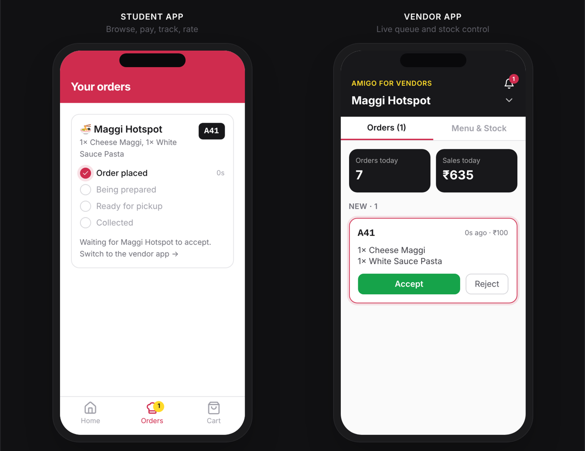
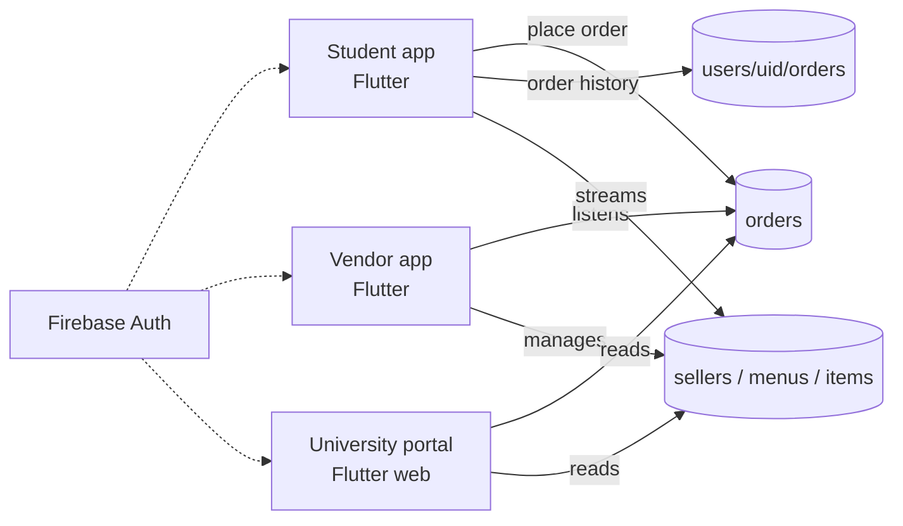

<div align="center">


# Amigo: Flavours of Your Choice

**Campus food ordering without the queue.** A student app, a vendor app and a university admin portal, built in Flutter on Firebase.

[**▶ Try the interactive demo**](https://dakshvasudev.vercel.app/project/amigo)


</div>

---

## The problem

Between classes, students had about ten minutes to eat. Campus stalls took orders on paper, queues ran long, and the university had no view of how its food court was doing: which stalls were slow, which were busy, what students thought of them.

## The solution

Amigo connects the three groups on one real-time backend:

| App | Who uses it | What it does |
|---|---|---|
| **Student app** (this repo) | Students | Browse stalls and menus, build a cart, place an order, follow its status until pickup |
| **Vendor app** | Stall owners | Live order queue, menu and stock management, daily sales |
| **University portal** (Flutter web) | Administration | Sales and performance per stall, reports, student feedback |

An order placed by a student reaches the vendor's queue instantly, and every status change flows back to the student and up to the portal.

## Try it in your browser

No install needed. The [interactive demo](https://dakshvasudev.vercel.app/project/amigo) recreates all three apps side by side, using the real stalls, menus and prices from this codebase:

1. Sign in on the student app and order from a stall
2. Accept it and mark it ready in the vendor app
3. Hand it over, rate it, and watch the university portal update




> The demo runs on sample data in your browser. The Flutter apps in this repo talk to Firebase.

## Features in this repo (student app)

- **Accounts:** email sign-up and login with Firebase Auth, profile photo upload to Firebase Storage
- **Live catalogue:** stalls → menus → items, streamed from Cloud Firestore with `snapshots()`, so a menu change shows up without a refresh
- **Cart:** add items with quantities, cart count and totals via Provider, cart kept on the device (SharedPreferences) and synced to the user's Firestore document so it survives a reinstall
- **Checkout:** saved pickup addresses, order placement
- **Orders:** order history and order details, each with a status banner

## Architecture



**Firestore data model**

```
sellers/{sellerUID}
  └─ menus/{menuID}
       └─ items/{itemID}
users/{uid}                 # profile, userCart
  ├─ orders/{orderID}       # the student's own history
  └─ userAddress/{id}
orders/{orderID}            # shared collection the vendor app listens to
```

Each order is written twice, to the student's history and to the shared `orders` collection, so the student app and the vendor app each read only what they need.

## Tech stack

| Area | Choice |
|---|---|
| UI | Flutter, Material, Google Fonts, carousel_slider, flutter_staggered_grid_view, flutter_zoom_drawer |
| State | Provider (cart count, totals) |
| Backend | Firebase Auth, Cloud Firestore, Firebase Storage |
| Local storage | SharedPreferences |

## Run it locally

Requirements: Flutter SDK compatible with Dart `>=2.18 <3.0` (Flutter 3.3 to 3.7 era).

```bash
git clone https://github.com/dakshvasudev/Amigo.git
cd Amigo
flutter pub get
```

Connect your own Firebase project before running (the app expects Auth, Firestore and Storage):

```bash
dart pub global activate flutterfire_cli
flutterfire configure        # replaces android/app/google-services.json with your project's
flutter run
```

## Project structure

```
lib/
├── authScreen/        # auth tabs, login, register
├── mainScreens/       # home, menus, items, item detail, cart, orders, order details
├── widgets/           # cards, app bars, cart item, status banner, dialogs
├── assistantMethods/  # cart helpers, cart counter, total amount (Provider)
├── model/, models/    # Items, Menus, Sellers
└── main.dart
```

## Team and my role

Built in 2023 at Bennett University by a team of five. I led the team and worked on the Flutter apps and the Firebase data model.

## Roadmap

- Online payment instead of pay-at-pickup
- Push notification when an order is ready
- Migrate to Dart 3 and current Firebase packages

---

<div align="center">

Made by [Daksh Vasudev](https://dakshvasudev.vercel.app/) · [LinkedIn](https://linkedin.com/in/daksh-vasudev)

</div>
